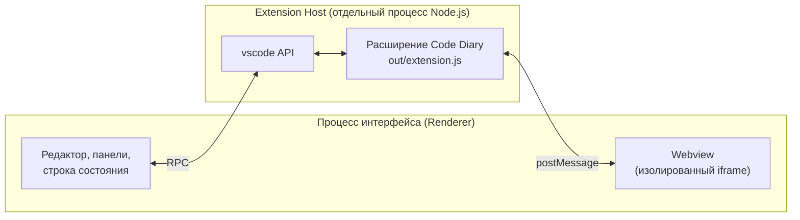
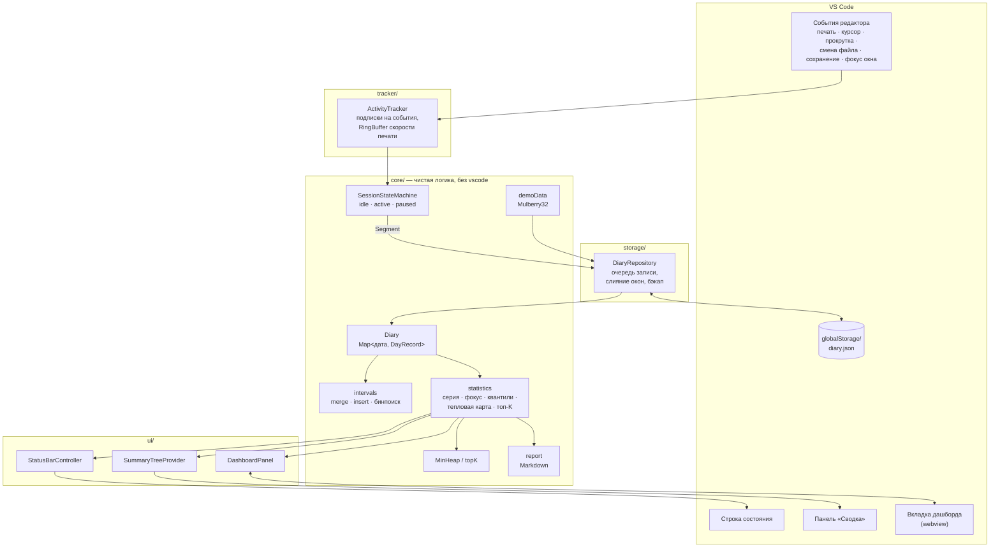
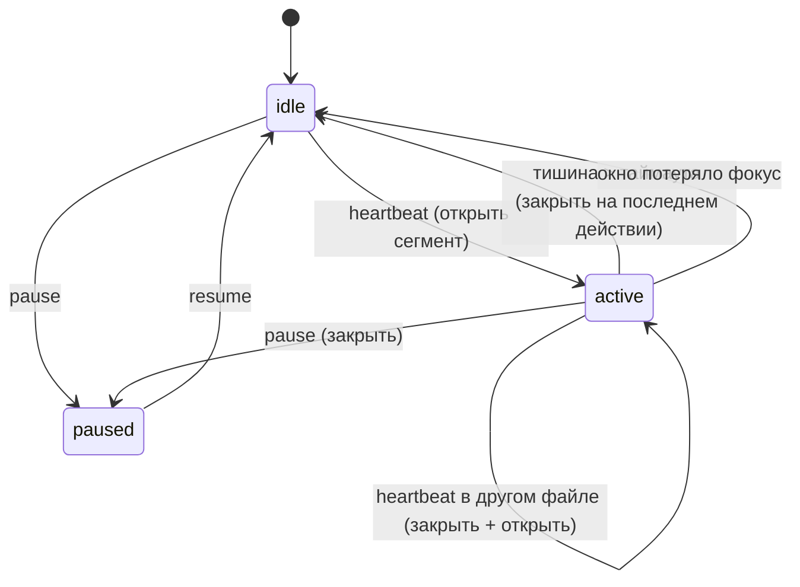

# Code Diary — документация проекта

**Плагин для Visual Studio Code** · автор: Гвоздев Матвей Георгиевич, группа М3106

Code Diary — «дневник программирования». Плагин незаметно фиксирует, когда и в каких
файлах вы пишете код, и показывает статистику: время за день и период, языки, проекты,
самые «горячие» файлы, распределение по часам суток, тепловую карту активности за год,
серию дней подряд и долю времени в сессиях фокуса.

> Подробные страницы по каждому классу и функции сгенерированы TypeDoc из JSDoc-комментариев:
> папка `docs/api` (откройте `docs/api/index.html` в браузере; пересобрать — `npm run docs`).

---

## Содержание

1. [Техническое задание](#1-техническое-задание)
2. [Как VS Code подключает расширения](#2-как-vs-code-подключает-расширения)
3. [Архитектура плагина](#3-архитектура-плагина)
4. [Автомат учёта времени](#4-автомат-учёта-времени)
5. [Структуры данных и алгоритмы](#5-структуры-данных-и-алгоритмы)
6. [Формат хранения](#6-формат-хранения)
7. [Команды и настройки](#7-команды-и-настройки)
8. [Сборка, запуск, тесты, документация](#8-сборка-запуск-тесты-документация)
9. [Структура репозитория](#9-структура-репозитория)

---

## 1. Техническое задание

**Назначение.** Помочь разработчику видеть, сколько времени он реально программирует,
на чём и как сосредоточенно, без ручного запуска таймеров.

**Функциональные требования**

| № | Требование |
|---|---|
| Ф1 | Автоматически учитывать время работы в редакторе по событиям: печать, перемещение курсора, прокрутка, переключение файлов, сохранение. |
| Ф2 | Не засчитывать простой: если нет действий дольше таймаута (по умолчанию 2 мин), сессия завершается на последнем действии. |
| Ф3 | Не засчитывать время, когда окно VS Code не в фокусе. |
| Ф4 | Хранить статистику по дням: интервалы активности, время по языкам, файлам, проектам, часам суток, число напечатанных символов. |
| Ф5 | Не удваивать время при нескольких открытых окнах VS Code. |
| Ф6 | Показывать время за сегодня в строке состояния с прогрессом к дневной цели и текущей серией дней. |
| Ф7 | Боковая панель «Сводка» на панели активности: сегодня, серия, фокус, скорость, топ языков и файлов (клик открывает файл). |
| Ф8 | Дашборд в отдельной вкладке: ключевые показатели, шкала дня, столбцы по дням, тепловая карта за год, языки, время суток, файлы, проекты, итоги периода; выбор периода «Сегодня / 7 дней / 30 дней / Всё время»; подсказки при наведении. |
| Ф9 | Дневная цель задаётся в свободном формате (`90`, `1:30`, `1ч 30м`, `2h`), один раз в день приходит уведомление о её достижении. |
| Ф10 | Пауза учёта, экспорт недельного отчёта в Markdown. |
| Ф11 | Демо-данные для показа, очистка данных, восстановление из резервной копии. |

**Нефункциональные требования**

- Оформление следует активной теме VS Code (светлой, тёмной, контрастной), минималистичное.
- Данные хранятся только локально, сеть не используется; страница дашборда работает со строгой CSP.
- Ядро логики не зависит от API VS Code и покрыто модульными тестами.
- Повреждённый файл данных не ломает плагин: он сохраняется отдельно, начинается новый дневник.

---

## 2. Как VS Code подключает расширения

VS Code построен так, что сторонний код никогда не выполняется в процессе интерфейса:



1. **Манифест `package.json`** описывает расширение декларативно:
   - `main` — точка входа (`./out/extension.js`);
   - `activationEvents` — когда загружать код (`onStartupFinished`: после запуска редактора, чтобы не замедлять старт);
   - `contributes` — «точки расширения» интерфейса: `commands` (палитра команд), `viewsContainers` и `views` (значок на панели активности и дерево «Сводка»), `menus` (кнопки в заголовке панели), `configuration` (настройки в `settings.json`).
   VS Code читает манифест **без запуска кода**: команды и панели видны сразу, а код загружается лениво.
2. **Extension Host** — отдельный процесс Node.js, где выполняются все расширения. Если расширение зависнет или упадёт, интерфейс редактора продолжит работать.
3. **Функция `activate(context)`** вызывается один раз. В ней расширение регистрирует команды, подписывается на события и создаёт элементы интерфейса. Всё, что нужно освободить, кладётся в `context.subscriptions`.
4. **API `vscode`** — единственный способ взаимодействия: события (`workspace.onDidChangeTextDocument`, `window.onDidChangeWindowState`…), элементы интерфейса (`createStatusBarItem`, `registerTreeDataProvider`, `createWebviewPanel`), хранилище (`context.globalStorageUri`).
5. **Webview** — HTML-страница в изолированном фрейме. Она не имеет доступа к Node.js и общается с расширением только сообщениями `postMessage`.
6. **Функция `deactivate()`** вызывается при закрытии окна. Code Diary дописывает в ней данные на диск.

---

## 3. Архитектура плагина



**Поток данных**

1. Пользователь печатает → VS Code генерирует событие → `ActivityTracker` превращает его в *heartbeat* с контекстом `{файл, язык, проект}`.
2. `SessionStateMachine` решает: продолжить текущий сегмент, закрыть его (простой, смена файла, потеря фокуса) или открыть новый.
3. Закрытый `Segment` уходит в `DiaryRepository`: сразу применяется к `Diary` в памяти и через 2 с пачкой пишется на диск.
4. `Diary.addSegment` режет сегмент по границам часов (и дней), вставляет интервалы с объединением пересечений, прибавляет время к языку, файлу, проекту и часу.
5. Раз в 10 с (и при каждом изменении) `computeDashboard` пересчитывает статистику, и интерфейс обновляется: строка состояния, дерево, дашборд. Ещё не закрытый сегмент добавляется к копии дневника, поэтому счётчик идёт «вживую».

**Модули**

| Модуль | Ответственность |
|---|---|
| `extension.ts` | Точка входа: создаёт компоненты, связывает события, регистрирует 7 команд. |
| `core/types.ts` | Типы: `Interval`, `Segment`, `DayRecord`, `DiaryData`, `StatsRange`. |
| `core/time.ts` | Ключи дней, сдвиг дат, границы часов, форматирование `2ч 14м`, склонения, разбор ввода цели. |
| `core/intervals.ts` | Слияние, вставка с бинарным поиском, обрезка интервалов. |
| `core/RingBuffer.ts` | Кольцевой буфер для скорости печати. |
| `core/MinHeap.ts` | Двоичная куча и выбор топ-K. |
| `core/SessionStateMachine.ts` | Конечный автомат сессий. |
| `core/Diary.ts` | Модель данных и раскладка сегментов по дням и часам; валидация при загрузке. |
| `core/statistics.ts` | Все показатели дашборда. |
| `core/report.ts` | Недельный отчёт в Markdown. |
| `core/demoData.ts` | Генератор воспроизводимых демо-данных. |
| `tracker/ActivityTracker.ts` | Мост «события VS Code → автомат». |
| `storage/DiaryRepository.ts` | Чтение и запись `diary.json`, очередь, резервная копия, восстановление после повреждения. |
| `ui/StatusBarController.ts` | Элемент строки состояния и подсказка с командными ссылками. |
| `ui/SummaryTreeProvider.ts` | Дерево «Сводка» (`TreeDataProvider`). |
| `ui/DashboardPanel.ts` | Webview-панель, CSP, обмен сообщениями. |
| `media/dashboard.js/.css` | Отрисовка дашборда внутри webview. |

---

## 4. Автомат учёта времени



Ключевая идея: сегмент закрывается в момент **последнего действия**, а не в момент
обнаружения тишины. Если пользователь ушёл на 20 минут, в статистику не попадёт ни секунды
из этих 20 минут.

Раз в минуту длинный сегмент «чекпойнтится»: его уже прошедшая часть записывается, а
сегмент продолжается. Если редактор упадёт, потеряется не больше минуты.

---

## 5. Структуры данных и алгоритмы

| Где | Структура / алгоритм | Сложность | Зачем |
|---|---|---|---|
| `Diary` | Хеш-таблица `Map<дата, DayRecord>` | O(1) доступ к дню | Быстрый доступ к любому дню. |
| `DayRecord.intervals` | Отсортированный список непересекающихся интервалов | — | Время дня без двойного счёта. |
| `insertInterval` | Бинарный поиск + поглощение соседей | O(log n + k) | Вставка нового отрезка с объединением. |
| `mergeIntervals` | Сортировка + один проход | O(n log n) | Объединение отрезков в сессии с допустимым перерывом. |
| `SessionStateMachine` | Конечный автомат | O(1) на событие | Превращение потока событий в сегменты. |
| `RingBuffer` | Кольцевой буфер | O(1) вставка | Последние нажатия для скорости печати за минуту. |
| `MinHeap` + `topK` | Двоичная куча размера k | O(n log k) | Топ языков, файлов, проектов. |
| `computeStreak` | Множество `Set` + проход по датам | O(d log d) | Текущая и рекордная серии. |
| `computeHeatmap` | Сетка 53×7 + квартили | O(d log d) | Уровни яркости тепловой карты подстраиваются под пользователя. |
| `quantile` | Линейная интерполяция | O(1) | Границы уровней. |
| `parseDurationToMinutes` | Регулярные выражения | O(len) | Ввод цели «1ч 30м», «1:30», «90». |
| `mulberry32` | ГПСЧ с зерном | O(1) | Воспроизводимые демо-данные. |

**Пример: объединение интервалов (`mergeIntervals`)**

```
вход:   [1,3] [2,6] [8,10] [15,18]
сорт.:  [1,3] [2,6] [8,10] [15,18]
шаг 1:  результат = [1,3]
шаг 2:  [2,6] начинается до конца [1,3] → расширяем до [1,6]
шаг 3:  [8,10] начинается после 6 → новый интервал
шаг 4:  [15,18] → новый интервал
выход:  [1,6] [8,10] [15,18]
```

**Пример: серия дней (`computeStreak`).** Активные дни: 20, 21, 22, 23, 26, 27, 28, 29 октября,
сегодня 30-е и ещё не начато. Текущая серия считается от вчера: 29, 28, 27, 26, получается 4.
Рекорд — самая длинная цепочка подряд, тоже 4. Как только сегодня появится минута работы,
серия станет 5.

**Пример: фокус.** Сессии за день: 40 мин и 10 мин. Сессия фокуса — от 25 мин. Значит, фокус
= 40 / (40 + 10) = 80%.

---

## 6. Формат хранения

Файл `diary.json` в `context.globalStorageUri` (общий для всех окон VS Code):

```json
{
  "version": 1,
  "days": {
    "2026-10-30": {
      "date": "2026-10-30",
      "intervals": [[1793347145925, 1793347152014]],
      "languages": { "typescript": 6089 },
      "files": { "lab3/src/extension.ts": 6089 },
      "projects": { "lab3": 6089 },
      "hours": [0, 0, 0, 0, 0, 0, 0, 0, 0, 0, 6089, 0, 0, 0, 0, 0, 0, 0, 0, 0, 0, 0, 0, 0],
      "chars": 175
    }
  }
}
```

Все длительности указаны в миллисекундах. Сырые события не хранятся, только агрегаты по дням:
год активной работы занимает порядка сотен килобайт.

**Несколько окон VS Code.** Перед каждой записью репозиторий перечитывает файл и добавляет
к свежей версии только новые сегменты своего окна. Если два окна учли один и тот же отрезок,
`insertInterval` объединит его, и время не удвоится.

---

## 7. Команды и настройки

| Команда (палитра `Ctrl/Cmd+Shift+P`) | Действие |
|---|---|
| `Code Diary: Открыть дашборд` | Вкладка со статистикой (также клик по строке состояния). |
| `Code Diary: Задать цель на день` | Ввод цели: `90`, `1:30`, `2ч`, `1ч 30м`, `1.5h`. |
| `Code Diary: Пауза / продолжить учёт` | Временно выключает учёт. |
| `Code Diary: Экспорт недельного отчёта (Markdown)` | Открывает отчёт за 7 дней в новом документе. |
| `Code Diary: Заполнить демо-данными` | Год правдоподобной истории (текущие данные уходят в резервную копию). |
| `Code Diary: Восстановить данные из резервной копии` | Отменяет последнюю замену данных. |
| `Code Diary: Очистить все данные` | Удаляет статистику (с резервной копией). |

| Настройка | По умолчанию | Описание |
|---|---|---|
| `codeDiary.dailyGoalMinutes` | `120` | Цель на день, минуты. |
| `codeDiary.idleTimeoutMinutes` | `2` | Тишина, после которой сессия завершается. |
| `codeDiary.focusSessionMinutes` | `25` | Минимальная длина сессии фокуса. |
| `codeDiary.showStatusBar` | `true` | Показывать элемент в строке состояния. |

---

## 8. Сборка, запуск, тесты, документация

Требуется Node.js 18+ и VS Code 1.90+.

```bash
npm install          # зависимости разработки
npm run compile      # TypeScript → out/
npm test             # 53 модульных теста ядра (node:test)
npm run docs         # HTML-документация TypeDoc → docs/api
npm run package      # сборка устанавливаемого файла code-diary-1.0.0.vsix
```

**Запуск в режиме разработки:** открыть папку проекта в VS Code и нажать **F5**.
Откроется окно *Extension Development Host* с подключённым плагином.

**Установка готового плагина:** `code --install-extension code-diary-1.0.0.vsix`
или в VS Code: *Extensions → … → Install from VSIX*.

---

## 9. Структура репозитория

```
├── package.json            манифест расширения (contribution points)
├── tsconfig.json           настройки компилятора
├── typedoc.json            настройки генератора документации
├── media/
│   ├── activity.svg        значок на панели активности
│   ├── dashboard.css       стили дашборда (переменные темы VS Code)
│   └── dashboard.js        отрисовка дашборда в webview
├── src/
│   ├── extension.ts        точка входа: activate / deactivate
│   ├── core/               чистая логика (без vscode), покрыта тестами
│   ├── tracker/            подписка на события редактора
│   ├── storage/            чтение/запись diary.json
│   ├── ui/                 строка состояния, дерево, webview
│   └── test/               модульные тесты
├── docs/api/               сгенерированная документация TypeDoc
├── README.md               описание, авторство, возможности
└── DOCUMENTATION.md        этот файл
```
