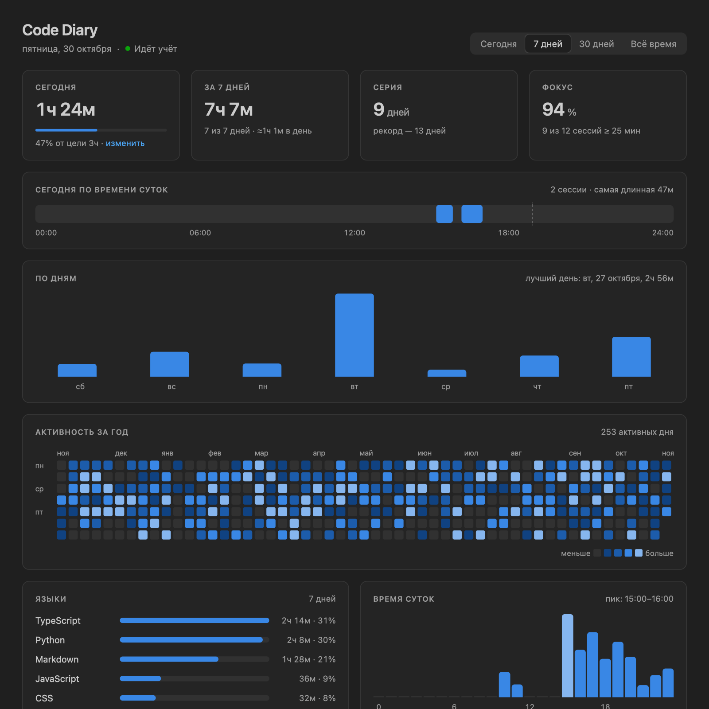
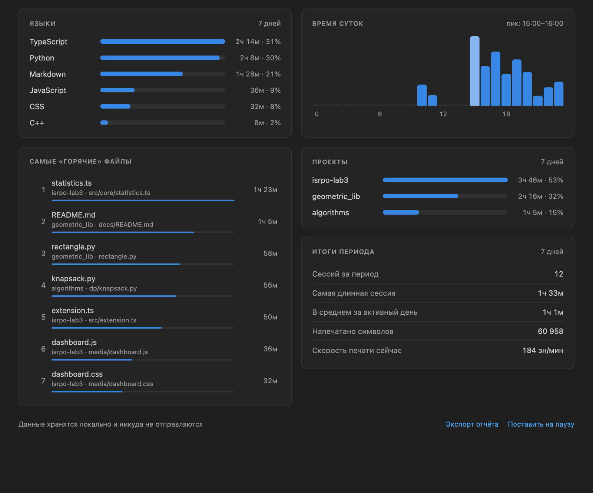

# Лабораторная работа №3 — плагин «Code Diary» для VS Code
## Цель: изучить архитектуру IDE с точки зрения подключения сторонних возможностей, написав собственный плагин

**Автор:** Гвоздев Матвей Георгиевич, группа **М3106**

**IDE:** Visual Studio Code · **Язык:** TypeScript · **Версия:** 1.0.0

> **Использование ИИ.** При выполнении работы использовалась нейросеть **Claude (Anthropic)**:
> помощь в проектировании архитектуры, написании кода, тестов и документации.
> Идея, требования (ТЗ), выбор решений, проверка работы и демонстрация — мои.

---

### Описание

**Code Diary** — «дневник программирования». Плагин незаметно фиксирует, когда, в каких файлах
и на каких языках вы пишете код, и показывает статистику: время за день и неделю, тепловую
карту активности за год, серию дней подряд, долю времени в сессиях фокуса, самые «горячие»
файлы и время суток, когда вы продуктивнее всего. Похоже на «Экранное время» в телефоне, только для программирования.

Плагин не просто включает секундомер. Он работает как **конечный автомат**: события редактора
превращаются в отрезки работы, простой не засчитывается, отрезки раскладываются по дням и
часам через **слияние интервалов**, а статистика строится с помощью **кучи**, **кольцевого
буфера**, **хеш-таблиц** и **квантилей**.



### Возможности

- **Автоматический учёт времени** по событиям редактора: печать, курсор, прокрутка, смена файла, сохранение.
- **Простой не засчитывается**: после 2 минут тишины (настраивается) сессия закрывается на последнем действии.
- **Не считает время**, когда окно VS Code не в фокусе.
- **Не удваивает время** при нескольких открытых окнах VS Code.
- **Строка состояния**: `⏱ 2ч 14м ✓ 🔥 5` — время за сегодня, отметка достижения цели, серия дней; подсказка с деталями.
- **Боковая панель «Сводка»**: сегодня, серия, фокус, скорость печати, топ языков и файлов (клик открывает файл).
- **Дашборд** в цветах вашей темы:
  - ключевые показатели: сегодня и прогресс к цели, итог за период, серия, фокус;
  - шкала текущего дня с сессиями;
  - столбцы по дням;
  - тепловая карта за год;
  - языки, время суток, файлы, проекты, итоги периода;
  - переключатель периода «Сегодня / 7 дней / 30 дней / Всё время»;
  - подсказки при наведении.
- **Дневная цель** в свободном формате: `90`, `1:30`, `2ч`, `1ч 30м`, `1.5h`; уведомление о её достижении.
- **Скорость печати** (знаков в минуту за последнюю минуту).
- **Пауза** учёта одной кнопкой.
- **Экспорт недельного отчёта** в Markdown.
- **Демо-данные** за год для демонстрации, **очистка** и **восстановление** из резервной копии.
- **Данные только локально**, без сети.



---

### ход работы
1. Установил Node.js: в нём собирается и тестируется плагин
`brew install node`
2. Создал манифест расширения `package.json`: точка входа, событие активации, команды, панель, меню и настройки (contribution points)
`npm init -y`
3. Установил TypeScript, типы API VS Code, генератор документации и упаковщик
`npm install --save-dev typescript @types/vscode @types/node typedoc @vscode/vsce`
4. Настроил компиляцию TypeScript в папку `out/`
`touch tsconfig.json`
5. Написал ядро без зависимостей от VS Code: интервалы, кольцевой буфер, кучу, автомат сессий, дневник, статистику, отчёт и демо-данные
`mkdir -p src/core && touch src/core/{types,time,intervals,RingBuffer,MinHeap,SessionStateMachine,Diary,statistics,report,demoData}.ts`
6. Написал слой VS Code: трекер событий, хранилище, строку состояния, дерево и webview-дашборд
`mkdir -p src/tracker src/storage src/ui media`
7. Написал модульные тесты ядра и прогнал их: **53 теста, 0 ошибок**
`npm test`
8. Запустил плагин в отладочном окне VS Code (*Extension Development Host*)
`F5`
9. Сгенерировал HTML-документацию из JSDoc-комментариев
`npm run docs`
10. Собрал устанавливаемый пакет плагина
`npm run package`

---

## Функции плагина

## Учёт времени
#### Автомат сессий — `SessionStateMachine.heartbeat`
***Как работает:*** состояния `idle → active → idle / paused`. Каждое действие пользователя — это heartbeat.
Пока действия идут чаще таймаута, сегмент продлевается. При тишине сегмент закрывается в момент
**последнего действия**. При смене файла старый сегмент закрывается и открывается новый.

***Принимает:*** time — **number** — момент действия, мс

***Принимает:*** ctx — **ActivityContext** — `{ file, language, project }`

***Принимает:*** chars — **number** — сколько символов напечатано

***Пример:*** действия в 10:00, 10:01, затем в 10:20 → два сегмента по 1 минуте, 19 минут простоя не учтены
```ts
heartbeat(time: number, ctx: ActivityContext, chars = 0): void {
    if (this.state === 'paused') return;
    const cur = this.current;
    if (this.state === 'active' && cur) {
        if (time - cur.lastBeat > this.idleTimeoutMs) {
            this.close(cur.lastBeat);          // простой не засчитываем
        } else if (sameContext(cur, ctx)) {
            cur.lastBeat = time;               // продлеваем сегмент
            cur.chars += chars;
            return;
        } else {
            this.close(time);                  // сменился файл
        }
    }
    this.current = { ...ctx, start: time, lastBeat: time, chars };
    this.state = 'active';
}
```
#### Скорость печати — `RingBuffer`
***Как работает:*** кольцевой буфер на 512 элементов хранит последние порции набранного текста
`[момент, символов]`. Скорость — сумма символов за последние 60 секунд.

***Принимает:*** item — **T** — новый элемент (самый старый вытесняется за O(1))

***Пример:*** `capacity = 3; push(1..5) → toArray() = [3, 4, 5]`
```ts
push(item: T): void {
    this.items[this.head] = item;
    this.head = (this.head + 1) % this.capacity;
    if (this.count < this.capacity) this.count++;
}
```
---
## Дневник
#### Слияние интервалов — `mergeIntervals`
***Алгоритм:*** сортировка по началу + один проход, O(n log n)

***Принимает:*** intervals — **Interval[]** — отрезки `[начало, конец]`

***Принимает:*** gap — **number** — допустимый разрыв (из отрезков получаются сессии)

***Пример:*** `mergeIntervals([[1,3],[2,6],[8,10],[15,18]]) = [[1,6],[8,10],[15,18]]`
```ts
const sorted = [...intervals].sort((a, b) => a[0] - b[0]);
const result: Interval[] = [[sorted[0][0], sorted[0][1]]];
for (let i = 1; i < sorted.length; i++) {
    const last = result[result.length - 1];
    const [start, end] = sorted[i];
    if (start <= last[1] + gap) last[1] = Math.max(last[1], end);
    else result.push([start, end]);
}
```
#### Вставка интервала — `insertInterval`
***Алгоритм:*** бинарный поиск места + поглощение пересекающихся соседей, O(log n + k).
Благодаря этому два окна VS Code не удваивают время.

***Принимает:*** list — **Interval[]** — отсортированные непересекающиеся интервалы

***Принимает:*** interval — **Interval** — новый отрезок

***Пример:*** `insertInterval([[1,2],[5,9]], [2,5]) = [[1,9]]`
```ts
const i = lowerBoundByEnd(list, start);          // бинарный поиск
let j = i;
while (j < list.length && list[j][0] <= end) {   // поглощаем соседей
    start = Math.min(start, list[j][0]);
    end = Math.max(end, list[j][1]);
    j++;
}
return [...list.slice(0, i), [start, end], ...list.slice(j)];
```
#### Раскладка сегмента по часам — `Diary.addSegment`
***Как работает:*** сегмент режется по границам часов. Каждый кусок попадает в свой час и свой
день (сегмент через полночь делится на два дня). Время прибавляется к языку, файлу и проекту
в хеш-таблицах.

***Принимает:*** segment — **Segment** — `{ start, end, file, language, project, chars }`

***Пример:*** сегмент 10:30–12:15 → `hours[10] = 30м, hours[11] = 60м, hours[12] = 15м`
```ts
let cursor = segment.start;
while (cursor < segment.end) {
    const pieceEnd = Math.min(nextHourStart(cursor), segment.end);
    const day = this.ensureDay(dayKey(cursor));
    day.intervals = insertInterval(day.intervals, [cursor, pieceEnd]);
    day.hours[new Date(cursor).getHours()] += pieceEnd - cursor;
    addTo(day.languages, segment.language, pieceEnd - cursor);
    cursor = pieceEnd;
}
```
---
## Статистика
#### Серия дней — `computeStreak`
***Как работает:*** активные дни (от 1 минуты) кладутся в `Set`. Текущая серия идёт назад от
сегодня; если сегодня ещё не начато, то от вчера. Рекорд — самая длинная цепочка подряд.

***Принимает:*** diary — **Diary** — дневник

***Принимает:*** today — **string** — сегодняшняя дата `YYYY-MM-DD`

***Пример:*** активны 20–23 и 26–29 октября, сегодня 30-е → `{ current: 4, longest: 4 }`
```ts
let current = 0;
for (let k = activeToday ? today : addDays(today, -1); active.has(k); k = addDays(k, -1)) {
    current++;
}
```
#### Фокус — `computeFocus`
***Формула:*** `Фокус = время в сессиях ≥ 25 мин / всё время`

***Принимает:*** days — **DayRecord[]** — дни периода

***Принимает:*** sessionGapMs — **number** — перерыв, не разрывающий сессию (5 мин)

***Принимает:*** focusSessionMs — **number** — порог сессии фокуса (25 мин)

***Пример:*** сессии 40 мин и 10 мин → `40 / 50 = 80%`

#### Топ-K — `topK`
***Алгоритм:*** куча с минимумом в корне размера k. Если в ней больше k элементов, выбрасываем
минимум. Сложность O(n log k) вместо O(n log n).

***Принимает:*** entries — **[string, number][]** — пары «имя, время»

***Принимает:*** k — **number** — размер топа

***Пример:*** `topK([['a',5],['b',50],['c',1],['d',20],['e',30]], 3) = [['b',50],['e',30],['d',20]]`
```ts
const heap = new MinHeap<[string, number]>((a, b) => a[1] - b[1]);
for (const entry of entries) {
    heap.push(entry);
    if (heap.size > k) heap.pop();
}
```
#### Тепловая карта — `computeHeatmap`
***Формула:*** уровень клетки 1–4 по **квартилям** ненулевых дней: `Q1, Q2, Q3`

***Принимает:*** diary — **Diary**, today — **string**

***Пример:*** у того, кто пишет по 20 минут, и у того, кто пишет по 8 часов, карта одинаково контрастна
```ts
values.sort((a, b) => a - b);
const thresholds = [quantile(values, 0.25), quantile(values, 0.5), quantile(values, 0.75)];
```
#### Разбор цели — `parseDurationToMinutes`
***Принимает:*** input — **string** — ввод пользователя

***Пример:*** `"90" = 90`, `"1:30" = 90`, `"1ч 30м" = 90`, `"1,5 часа" = 90`, `"2h 15m" = 135`, `"abc" = undefined`

---

## Команды

| Команда (`Ctrl/Cmd+Shift+P`) | Действие |
|---|---|
| `Code Diary: Открыть дашборд` | вкладка со статистикой (или клик по строке состояния) |
| `Code Diary: Задать цель на день` | цель в свободном формате |
| `Code Diary: Пауза / продолжить учёт` | временно выключить учёт |
| `Code Diary: Экспорт недельного отчёта (Markdown)` | отчёт за 7 дней в новом документе |
| `Code Diary: Заполнить демо-данными` | год правдоподобной истории для демонстрации |
| `Code Diary: Восстановить данные из резервной копии` | отменить замену данных |
| `Code Diary: Очистить все данные` | удалить статистику (с резервной копией) |

## Настройки

| Настройка | По умолчанию | Описание |
|---|---|---|
| `codeDiary.dailyGoalMinutes` | `120` | цель на день, минуты |
| `codeDiary.idleTimeoutMinutes` | `2` | тишина, после которой сессия завершается |
| `codeDiary.focusSessionMinutes` | `25` | минимальная длина сессии фокуса |
| `codeDiary.showStatusBar` | `true` | показывать время в строке состояния |

---

### Установка и запуск
```bash
npm install
npm run compile
# далее F5 в VS Code — откроется окно с подключённым плагином
```
Готовый пакет: `npm run package` → `code --install-extension code-diary-1.0.0.vsix`

### Документация
- [DOCUMENTATION.md](DOCUMENTATION.md) — ТЗ, архитектура VS Code и плагина, диаграммы, алгоритмы, формат данных
- `docs/api/index.html` — HTML-документация по всем классам и функциям (TypeDoc, `npm run docs`)

---

## история в хэшах:
<!-- после загрузки на GitHub вставьте сюда вывод `git log --oneline` -->
